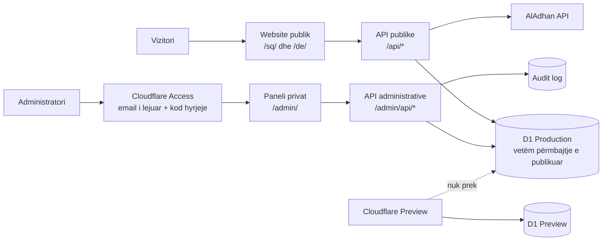
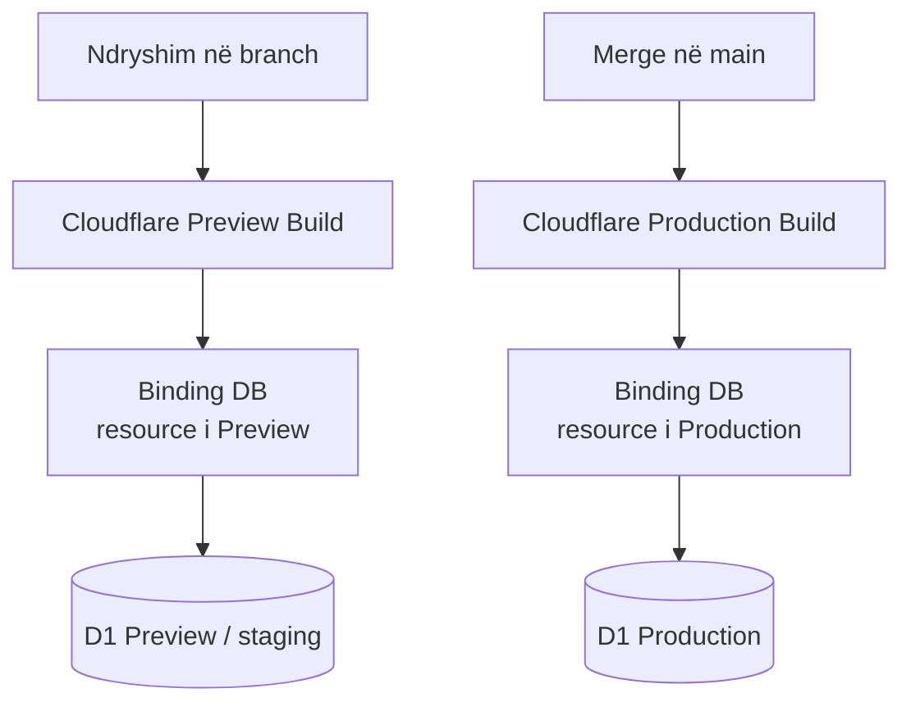

# Seksioni 01 · Arkitektura dhe siguria

Data e projektimit: 18 nëntor 2026

Statusi: Projektim për shqyrtim; nuk janë krijuar ende databaza, politika Access ose route administrative

Branch: `codex/docs-module-02-architecture`

## Qëllimi

Të përcaktohet si do të ndërtohet paneli administrativ përpara se të shkruhet kodi. Projektimi ndan qartë website-in publik, zonën private, të dhënat Production dhe të dhënat Preview.

## Arkitektura e propozuar



### Komponentët

| Komponenti | Përgjegjësia |
| --- | --- |
| Website-i publik | Shfaq vetëm përmbajtje të publikuar dhe vazhdon të funksionojë pa hyrje administrative. |
| Cloudflare Access | Autentikon dhe lejon vetëm email-in e aprovuar për `/admin/*`. |
| Paneli `/admin/` | Ofron formularë dygjuhësh dhe pamje për draft/publikim. |
| API `/admin/api/*` | Kontrollon identitetin, autorizimin, validimin dhe shkrimin në D1. |
| API `/api/*` | Jep vetëm të dhëna publike; nuk pranon operacione administrative. |
| D1 Production | Ruan të dhënat reale të publikuara. |
| D1 Preview | Ruan të dhëna testuese të branch-eve pa prekur Production. |
| Audit log | Regjistron aktorin, veprimin, entitetin dhe kohën e ndryshimit. |

## Zgjedhja e autentikimit

Përdoret Cloudflare Access dhe jo një sistem i ri username/password.

Arsyet:

- fjalëkalimet nuk ruhen nga aplikacioni;
- Cloudflare e ndalon kërkesën para se ajo të arrijë te paneli;
- `workers.dev`, Worker Previews dhe rrugë të veçanta mund të mbrohen me Access;
- identiteti i administratorit mund të përdoret në audit log;
- i njëjti mekanizëm vlen më vonë edhe për domain personal.

Do të krijohet një aplikacion Access për:

```text
xhamia-shpetimi.liridon-halimi.workers.dev/admin/*
```

Rrugët administrative të API-së vendosen qëllimisht brenda `/admin/api/*`. Kështu, paneli dhe kërkesat e tij përdorin të njëjtën zonë të mbrojtur dhe të njëjtën seancë Access.

Në versionin e parë Access lejon vetëm një email të konfirmuar nga pronari i projektit. Email-i nuk shkruhet në repository. Kur të nevojiten disa përdorues, shtohet autorizimi me role `admin` dhe `editor` si fazë e veçantë.

### Mbrojtja brenda Worker-it

Access është barriera e parë, por API-ja administrative nuk mbështetet vetëm te fakti se rruga është private. Worker-i kontrollon edhe identitetin e autentikuar:

1. kërkesa duhet të ketë kaluar në Cloudflare Access;
2. token-i/identiteti duhet të jetë valid për aplikacionin e duhur;
3. email-i duhet të jetë i lejuar nga politika;
4. vetëm metodat dhe `Content-Type` e pritshme pranohen;
5. çdo input validohet para query-t në D1;
6. çdo shkrim regjistrohet në audit log.

Për API-në preferohet `ctx.access` kur është i disponueshëm. Gjatë implementimit do të testohet kufizimi i Static Assets; nëse konteksti nuk përcillet në route-in administrativ, validohet header-i `Cf-Access-Jwt-Assertion` me issuer-in dhe audience-in e aplikacionit. Vlerat `TEAM_DOMAIN` dhe `POLICY_AUD` ruhen si konfigurim/secrets të Cloudflare, jo në kod.

## Modeli fillestar i të dhënave

### `announcements`

Ruan njoftimet dygjuhëshe.

| Fusha | Qëllimi |
| --- | --- |
| `id` | Identifikues unik. |
| `status` | `draft`, `published` ose `archived`. |
| `title_sq`, `title_de` | Titulli në të dyja gjuhët. |
| `body_sq`, `body_de` | Përmbajtja në të dyja gjuhët. |
| `starts_at`, `ends_at` | Kohë opsionale për dukshmërinë. |
| `published_at` | Koha reale e publikimit. |
| `created_at`, `updated_at` | Gjurmimi teknik. |
| `created_by`, `updated_by` | Email-i i identitetit Access. |

Rregull: një njoftim nuk mund të publikohet nëse mungon titulli ose përmbajtja në njërën gjuhë.

### `prayer_overrides`

Ruan vetëm orare të miratuara nga xhamia, si orari me xhemat ose xhumaja. Nuk zëvendëson automatikisht llogaritjen MWL/Hanafi të AlAdhan.

| Fusha | Qëllimi |
| --- | --- |
| `service_date` | Data lokale `Europe/Berlin`. |
| `fajr`, `dhuhr`, `asr`, `maghrib`, `isha` | Orët e miratuara, kur ekzistojnë. |
| `jummah_1`, `jummah_2` | Orari/et opsionale të xhumasë. |
| `note_sq`, `note_de` | Sqarim dygjuhësh opsional. |
| `status` | Draft ose published. |
| fushat e auditimit | Krijuesi dhe koha e ndryshimit. |

Emri përfundimtar i fushave dhe dallimi vizual mes kohës së ezanit dhe kohës me xhemat do të miratohen para implementimit të Seksionit 05.

### `site_settings`

Ruan vetëm konfigurime publike që janë konfirmuar. Të dhënat ligjore, IBAN/BIC real dhe domain-i nuk plotësohen derisa përdoruesi t'i sigurojë.

### `audit_log`

Ruan:

- aktorin;
- veprimin (`create`, `update`, `publish`, `archive`);
- llojin dhe ID-në e entitetit;
- datën dhe orën;
- një përmbledhje të sanitizuar të ndryshimit.

Audit log nuk ruan token-a, secrets ose përmbajtje të panevojshme personale.

## Kufijtë e API-së

### Publike

```text
GET /api/prayer-times          ekziston; llogarit MWL/Hanafi
GET /api/announcements         vetëm njoftimet published
GET /api/prayer-overrides      vetëm oraret published
```

### Administrative

```text
GET    /admin/api/session
GET    /admin/api/announcements
POST   /admin/api/announcements
GET    /admin/api/announcements/:id
PATCH  /admin/api/announcements/:id
POST   /admin/api/announcements/:id/publish
POST   /admin/api/announcements/:id/archive

GET    /admin/api/prayer-overrides
POST   /admin/api/prayer-overrides
PATCH  /admin/api/prayer-overrides/:id
POST   /admin/api/prayer-overrides/:id/publish

GET    /admin/api/audit-log
```

`DELETE` nuk përdoret në versionin e parë për përmbajtje të publikuar. Arkivimi është më i sigurt dhe ruan historikun.

## Ndarja e mjediseve



Rregullat:

- Preview nuk lidhet kurrë me ID-në e databazës Production.
- Migrimet provohen fillimisht lokalisht dhe në D1 Preview.
- Migrimet Production ekzekutohen vetëm pas aprovimit dhe para kodit që varet prej tyre.
- Tabelat nuk krijohen gjatë request-it.
- Çdo migration është skedar i versionuar në repository.
- Backup/export bëhet para migrimeve që ndryshojnë të dhëna ekzistuese.

## Siguria e input-it dhe përgjigjeve

- SQL përdor vetëm prepared statements dhe parametra.
- HTML nuk ruhet ose renderohet pa sanitizim; versioni i parë ruan tekst të thjeshtë.
- Madhësia e body-t kufizohet.
- Datat dhe orët validohen në `Europe/Berlin`.
- Gabimet publike nuk tregojnë stack trace, query ose konfigurim.
- Mutacionet pranojnë vetëm kërkesa same-origin me JSON.
- Rate limiting dhe logimi i gabimeve shtohen para publikimit të panelit.
- CSP dhe security headers ekzistuese ruhen edhe për panelin.

## Sjellja kur një shërbim dështon

- Nëse AlAdhan nuk përgjigjet, website-i shfaq mesazh të qartë dhe nuk shpik orare.
- Nëse D1 nuk përgjigjet, website-i publik vazhdon me përmbajtjen statike dhe njoftimet dinamike nuk shfaqen.
- Nëse Access nuk është konfiguruar, `/admin/api/*` kthen `403`; nuk lejohet mënyrë e hapur rezervë.
- Draftet nuk shfaqen kurrë në API-në publike.

## Pamja e panelit

Paneli do të ndjekë identitetin vizual ekzistues, por me hierarki më funksionale:

- sidebar: Përmbledhje, Njoftime, Orari, Audit log;
- header: mjedisi aktual, identiteti i përdoruesit dhe dalje;
- badge e dukshme `PREVIEW` ose `PRODUCTION`;
- formular dygjuhësh me kolonat SQ/DE;
- preview para publikimit;
- dialog konfirmimi për Publish dhe Archive;
- layout responsive për laptop dhe telefon.

Paneli nuk do të ketë buton që pretendon ruajtje pa e përfunduar lidhjen reale me D1.

## Rendi i implementimit

1. Krijimi i D1 Preview dhe Production, migrimi fillestar dhe testet e repository layer.
2. Konfigurimi i Cloudflare Access dhe guard-i i API-së.
3. Skeleti responsive i `/admin/` me gjendje reale të sesionit.
4. CRUD i njoftimeve: draft, preview, publish, archive.
5. Orari i miratuar dhe dallimi nga kohët e llogaritura MWL/Hanafi.
6. Leximi i të dhënave published nga website-i publik.
7. Audit log, validime negative, headers, rate limits dhe QA.
8. Dokumentimi teknik/klient dhe kontrolli final.

Çdo pikë ndahet në Pull Request të vogël dhe kontrollohet në Cloudflare Preview para merge.

## Vendimet që kërkohen para implementimit përkatës

- Email-i i vetëm që do të lejohet nga Cloudflare Access.
- Nëse njoftimet publikohen menjëherë apo mund të planifikohen me `starts_at`/`ends_at`.
- Forma zyrtare e orarit me xhemat dhe xhumasë.
- Nëse roli `editor` nevojitet që në versionin e parë apo më vonë.

Asnjë nga këto nuk bllokon krijimin e D1 schema-s bazë dhe testet lokale; vlerat reale nuk do të vendosen pa konfirmim.

## Burimet zyrtare

- [Cloudflare Access për Workers](https://developers.cloudflare.com/workers/configuration/cloudflare-access/)
- [Validimi i Access JWT](https://developers.cloudflare.com/cloudflare-one/access-controls/applications/http-apps/authorization-cookie/validating-json/)
- [Cloudflare Worker Previews](https://developers.cloudflare.com/workers/previews/)
- [Resources dhe izolimi i Preview](https://developers.cloudflare.com/workers/previews/resources/)
- [Konfigurimi i Preview](https://developers.cloudflare.com/workers/previews/configuration/)
- [D1 migrations](https://developers.cloudflare.com/d1/reference/migrations/)
- [D1 local development](https://developers.cloudflare.com/d1/best-practices/local-development/)

## Komandat e ekzekutuara gjatë projektimit

```bash
git status --short --branch
git log -5 --oneline
cat wrangler.jsonc
sed -n '1,240p' src/worker.mjs
find docs -maxdepth 3 -type f -print | sort
rg -n "Moduli 02|Module 02|administr|panel|njoftim|orar" \
  README.md docs src tests package.json
git switch -c codex/docs-module-02-architecture
git diff --check
npm run build
npm run lint
npm test
```

Rezultati:

- `main` ishte i pastër dhe i sinkronizuar me `origin/main`;
- nuk ekzistonte D1 binding, route administrative ose kod autentikimi;
- website-i ka tashmë `/api/prayer-times` dhe Worker Static Assets;
- branch-i i projektimit u krijua pa ndryshuar Production.
- build-i dhe lint kaluan pa gabime;
- të 18 testet ekzistuese kaluan;
- `git diff --check` nuk raportoi gabime formatimi.

## Kriteret e pranimit të projektimit

- [x] Website-i publik dhe paneli privat janë ndarë qartë.
- [x] Autentikimi nuk ruan fjalëkalime në aplikacion.
- [x] D1 Preview nuk prek D1 Production.
- [x] Draftet nuk ekspozohen në API publike.
- [x] Përmbajtja SQ/DE është pjesë e modelit që nga fillimi.
- [x] Audit log është pjesë e arkitekturës.
- [x] Të dhënat reale të pakonfirmuara nuk janë shpikur.
- [x] Domain-i personal dhe indeksimi publik mbeten jashtë këtij moduli tani për tani.
